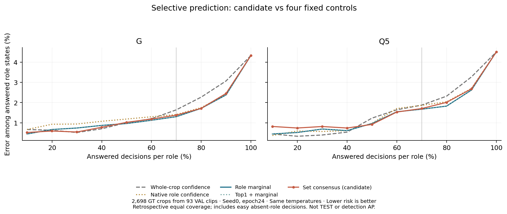
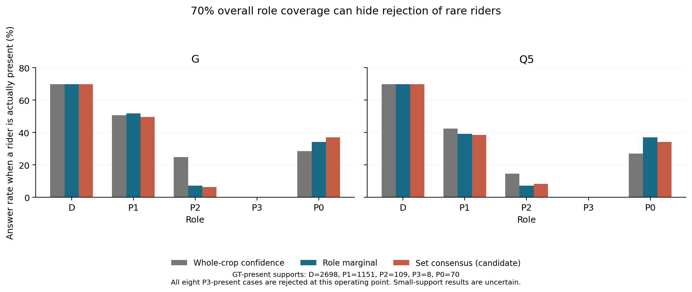

# Bảng kết quả nghiên cứu

Số liệu lấy từ evidence JSON kèm theo. Đơn vịAP là%; Δ là điểm phần trăm. Các bảng khác population hoặc sốepoch không được so chéo như một thí nghiệm ghép cặp.

## 1. Baseline3seed — endpoint24

| Seed | G macro | Q5 macro | G weighted | Q5 weighted |
|---|---:|---:|---:|---:|
| 0 | 30.5497 | 29.8999 | 75.7269 | 74.3420 |
| 1 | 27.6339 | 26.4812 | 75.6275 | 74.3241 |
| 2 | 27.4063 | 27.4213 | 75.1653 | 74.1739 |

Seed0 đã tham gia phát triển recipe; seed1/2 chạy lại recipe đó. Detector giữseed0. Bằng chứng: [baseline3seed](../evidence/gq5_three_seeds_verified_20261029.json).

## 2. Pilot loss —4epoch,seed0,toànVAL14.600frame

| Mô hình | Loss | Macro | Weighted | Δmacro so cùngarmBCE |
|---|---|---:|---:|---:|
| G | BCEgốc | 28.8617 | 75.4987 | — |
| G | omit_constant_presence | 25.9325 | 75.4368 | -2.9292 |
| G | valid_state_conditional | 26.0393 | 75.5405 | -2.8224 |
| Q5 | BCEgốc | 26.0287 | 74.4616 | — |
| Q5 | omit_constant_presence | 27.1865 | 74.2340 | +1.1578 |
| Q5 | valid_state_conditional | 28.0267 | 74.4032 | +1.9980 |

Một lớp chỉ1GT góp+2,9630điểm macro vào cảhai cải tiếnQ5; tổnggain lầnlượt+1,1578và+1,9980. Đây là phân rã độnhạy, không loại lớp khỏi metric. Không kết luận đã sửa được vaihiếm. [Số đo và hash](../evidence/helmet_completed_measurements_verified_20261029.json), [độ nhạy](../evidence/q5_solution_diagnosis_20261029.json).

## 3. Hybrid residual —4epoch,seed0,toànVAL

| Mô hình | Macro | Weighted |
|---|---:|---:|
| GQ5_residual | 28.4408 | 75.6854 |
| G_capacity392 | 21.6567 | 75.0036 |

GQ5residual thua Ggốc0,4209điểm macro, tăng0,1867điểm weighted. Gate không đạt. [Receipt và hash](../evidence/github_publication_snapshot_20261029.json).

## 4. Ensemble3seed —9.400frame,94clip ngoài calibration,24lớp

| Model | Xử lý | Macro | Weighted |
|---|---|---:|---:|
| G | raw | 29.7658 | 79.0044 |
| G | temperature | 33.3914 | 80.6108 |
| G | temperature_logit_adjustment | 33.3914 | 80.6108 |
| Q5 | raw | 28.1992 | 78.8736 |
| Q5 | temperature | 32.1445 | 80.4994 |
| Q5 | temperature_logit_adjustment | 32.1445 | 80.4994 |

G vàQ5 đều chọnτ0. Nhiệtđộ áp lênlog(mean36class probabilities), khác với temperature lênnative10logits. Đây làensembleđượcchấm lại, không phải trungbìnhAP của3seed. [Bằng chứng cuối](../evidence/ensemble3_final_verified_20261029.json).

## 5. Selective role pilot —2.698cropGT,93clip ngoài fit

Cùng1.888câu trả lời ởmỗivai,9.440decision tổng. Risk làlỗi trongphầntrảlời, **không phảiAP/accuracy toànhệthống**.

| Model | Policy | Risk (%) ↓ |
|---|---|---:|
| G | crop_confidence | 1.6419 |
| G | role_marginal | 1.3030 |
| G | set_consensus | 1.3771 |
| Q5 | crop_confidence | 1.8750 |
| Q5 | role_marginal | 1.6737 |
| Q5 | set_consensus | 1.7055 |

Cả8trường hợpP3 cóngười đều bịtừchối ởcoverage này. Ứngviên không đạtgate; không trìnhbày như thànhcôngphươngpháp.

[Kết quả đầy đủ](../evidence/selective/result.json).

## 6. Long-tail đang chạy

G/Q5×seed0/1/2,12epoch/fit,VAL12,fixedgamma+=0/gamma−=1 cho presence,helmetBCEmask khôngđổi. Dùngbaseline cùngseed/epoch12. Không đưa loss batch đangtrain thành kếtquả nghiêncứu. Snapshot: 2026-10-29T16:47:56.798214+00:00 UTC; xem [trạng thái](../evidence/github_publication_snapshot_20261029.json).

Không bảođảm nhận bài. Kếtluận phươngpháp cầntestkhóa,đối chứng vàkiểmtrađộbấtđịnh.
